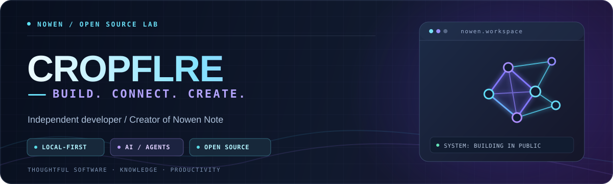
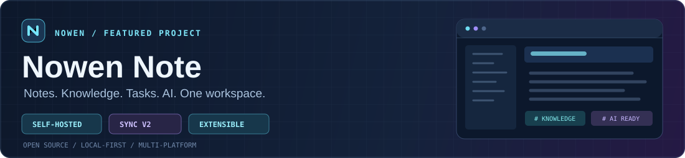

  

  <h2>Hi, I'm Drug 👋</h2>
  
<strong>开源产品开发者 · Nowen Note Creator · Building thoughtful software.</strong>

  
  

    
    
    
  

---

### // ABOUT ME

我喜欢把复杂的问题做成简单、可靠、顺手的工具。专注 **Web 前端、跨端桌面应用、个人知识管理与 AI Agent**，持续维护自己的开源项目。

> I build open-source tools where **ideas, knowledge and actions** come together.

- **Building:** [Nowen Note（弄文笔记）](https://github.com/cropflre/nowen-note) — 开源、自托管的知识与生产力工作台
- **Exploring:** Local-first · Multi-device Sync · MCP · RAG · AI Agents · Plugin Systems
- **Working with:** TypeScript · React · Vue · Electron · Node.js · Docker

### // FEATURED PROJECT

  

 

**[Nowen Note / 弄文笔记](https://github.com/cropflre/nowen-note)** — 一套数据由自己掌控、可部署在 NAS / 服务器上的开源知识与生产力系统。

| CORE MODULES | WHAT IT DOES |
| :--- | :--- |
| **01 / KNOWLEDGE** | 富文本与 Markdown、统一知识树、知识检索 |
| **02 / LOCAL-FIRST** | 离线工作区、Sync V2、多端增量同步 |
| **03 / INTELLIGENCE** | AI 写作、RAG 问答、MCP 与智能任务 |
| **04 / EXTENSIBILITY** | 插件系统、API、Webhook、浏览器剪藏 |
| **05 / EVERYWHERE** | Web、Electron 桌面端、Android 与 NAS |

  
  
  

### // TOOLKIT

  

 

  
  
  

### // GITHUB TELEMETRY

  
  

### // CONTRIBUTION SNAKE

  <picture>
    <source media="(prefers-color-scheme: dark)" srcset="https://raw.githubusercontent.com/cropflre/cropflre/output/github-contribution-grid-snake-dark.svg" />
    <source media="(prefers-color-scheme: light)" srcset="https://raw.githubusercontent.com/cropflre/cropflre/output/github-contribution-grid-snake-light.svg" />
    
  </picture>
  Auto-generated by <a href="https://github.com/Platane/snk">Platane/snk</a> · Updated daily via GitHub Actions

---

  <strong>Build with curiosity. Ship with care.</strong> 
  Made with ☕ and open source · <a href="https://github.com/cropflre">GitHub</a> · <a href="https://nowen.cn/">Nowen</a>

