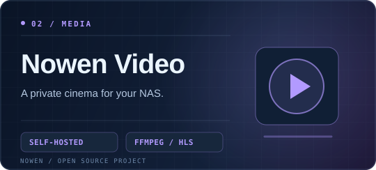
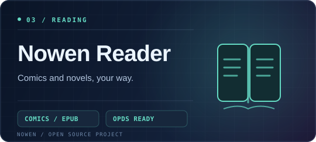
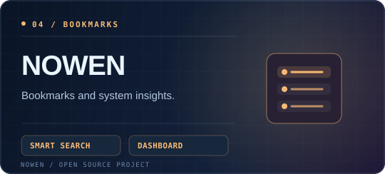

  

  <h2>Hi, I'm Drug 👋</h2>
  
<strong>开源产品开发者 · Nowen Note Creator · Building thoughtful software.</strong>

  
  

    
    
    
  

---

### // ABOUT ME

我喜欢把复杂的问题做成简单、可靠、顺手的工具。专注 **Web 前端、跨端桌面应用、个人知识管理与 AI Agent**，持续维护自己的开源项目。

> I build open-source tools where **ideas, knowledge and actions** come together.

- **Building:** [Nowen Note](https://github.com/cropflre/nowen-note) · [Nowen Video](https://github.com/cropflre/nowen-video) · [Nowen Reader](https://github.com/cropflre/nowen-reader) · [NOWEN 书签](https://github.com/cropflre/NOWEN)
- **Exploring:** Local-first · Multi-device Sync · MCP · RAG · AI Agents · Plugin Systems
- **Working with:** TypeScript · React · Vue · Electron · Node.js · Docker

### // NOWEN PROJECT ECOSYSTEM

  
<strong>Four open-source projects. One idea: make software simpler, more useful, and truly yours.</strong>

  四个产品方向 · 统一的 Nowen 视觉语言 · 自托管与开放优先

 

<table>
  <tr>
    <td width="50%" valign="top">
      
      
<b><a href="https://github.com/cropflre/nowen-note">Nowen Note · 弄文笔记</a></b> 
      开源知识与生产力工作台：统一知识树、富文本 / Markdown、任务中心、AI RAG、离线工作区和多端同步。

      
 

    </td>
    <td width="50%" valign="top">
      
      
<b><a href="https://github.com/cropflre/nowen-video">Nowen Video · 弄文影视</a></b> 
      NAS 私人家庭影音平台：媒体扫描与刮削、影视库管理、字幕、在线播放、Remux 和按需 HLS 转码。

      
 

    </td>
  </tr>
  <tr>
    <td width="50%" valign="top">
      
      
<b><a href="https://github.com/cropflre/nowen-reader">Nowen Reader · 弄文阅读</a></b> 
      轻量自托管漫画与小说平台：多格式书库、元数据管理、OPDS、阅读进度与可选 AI 智能辅助。

      
 

    </td>
    <td width="50%" valign="top">
      
      
<b><a href="https://github.com/cropflre/NOWEN">NOWEN · 弄文书签 / 星云门户</a></b> 
      个人导航与书签管理：分类标签、Spotlight 搜索、AI 标签、主题切换，以及服务器与 Docker 运行状态监控。

      
 

    </td>
  </tr>
</table>

  

### // TOOLKIT

  

 

  
  
  

### // GITHUB TELEMETRY

  
  

### // CONTRIBUTION SNAKE

  <picture>
    <source media="(prefers-color-scheme: dark)" srcset="https://raw.githubusercontent.com/cropflre/cropflre/output/github-contribution-grid-snake-dark.svg" />
    <source media="(prefers-color-scheme: light)" srcset="https://raw.githubusercontent.com/cropflre/cropflre/output/github-contribution-grid-snake-light.svg" />
    
  </picture>
  Auto-generated by <a href="https://github.com/Platane/snk">Platane/snk</a> · Updated daily via GitHub Actions

---

  <strong>Build with curiosity. Ship with care.</strong> 
  Made with ☕ and open source · <a href="https://github.com/cropflre">GitHub</a> · <a href="https://nowen.cn/">Nowen</a>

